# Linux-Server-Active-Directory-Lab
Hands-on Ubuntu Server and Samba Active Directory lab covering user management, Kerberos authentication, DNS troubleshooting, and SMB access control.  
# Linux Server & Active Directory Administration Lab

**Ubuntu Server 24.04 LTS | Samba Active Directory | DNS | Kerberos | SMB File Sharing**

## Project Overview

This project demonstrates hands-on experience configuring, administering, and troubleshooting a Linux-based Active Directory environment using Ubuntu Server and Samba.

The lab simulates common IT Support, System Administration, and Identity and Access Management (IAM) responsibilities, including:

- Linux server administration and configuration
- Samba Active Directory Domain Controller management
- DNS configuration and troubleshooting
- Kerberos authentication and ticket verification
- Active Directory user and security group management
- Password resets and user account lifecycle administration
- Secure SMB file sharing and group-based access control
- Troubleshooting, verification, and technical documentation

The project is organized into six practical case studies. Each case documents the objective, technical steps, screenshot evidence, and verified outcome.

---

## Lab Environment

| Component | Configuration |
|---|---|
| Host Machine | Apple Silicon Mac (M4) |
| Virtualization | VMware Fusion |
| Operating System | Ubuntu Server 24.04.4 LTS (ARM64) |
| Domain Controller | Samba 4.19.5 |
| Server Hostname | dc01 |
| Active Directory Domain | nishatlab.local |
| Kerberos Realm | NISHATLAB.LOCAL |
| Workgroup | NISHATLAB |
| Network | VMware NAT |
| Server IP Address | 192.168.204.130 |
| DNS Service | Samba Internal DNS |
| Authentication | Kerberos |
| File Sharing | SMB/CIFS |

### Tools & Technologies

- Ubuntu Server and Linux CLI
- Samba Active Directory Domain Controller
- Samba-tool and testparm
- Kerberos (kinit, klist)
- DNS utilities (host, resolvectl)
- SMBClient
- Netplan
- systemd and journalctl
- VMware Fusion

---

# Case 01 — Ubuntu Server & Active Directory Environment

## Objective

Establish an Ubuntu Server virtual machine and configure Samba Active Directory services to provide centralized domain authentication and administration.

## Steps Performed

1. Installed Ubuntu Server 24.04.4 LTS in VMware Fusion.
2. Configured the server hostname and VMware NAT networking.
3. Installed and configured Samba Active Directory services.
4. Established the domain `nishatlab.local`.
5. Configured the Kerberos realm `NISHATLAB.LOCAL`.
6. Verified the server environment and Samba configuration.

## Verification Commands

```bash
hostnamectl
sudo testparm -s
sudo systemctl status samba-ad-dc
```

### Screenshot 01 — Ubuntu Server Version

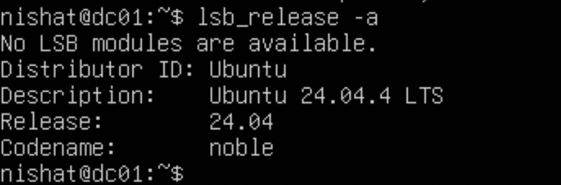

## Outcome

Established a virtualized Ubuntu Server environment for Active Directory administration, authentication testing, and network service configuration.

**Skills Demonstrated:** Linux Server Administration, Virtualization, Samba Configuration, System Administration.

---

# Case 02 — Active Directory DNS Configuration & Troubleshooting

## Problem

During the Samba Active Directory configuration, DNS resolution issues affected domain service discovery and authentication.

The troubleshooting process involved investigating Samba DNS errors, resolver settings, port 53 conflicts, Netplan configuration, and DNS forwarding behavior.

## Troubleshooting Steps

### Step 1 — Investigated Samba DNS Errors

Reviewed Samba service logs to identify DNS-related errors and service issues.

```bash
sudo journalctl -u samba-ad-dc --no-pager
```

**Screenshot 02 — Samba DNS Error Logs**

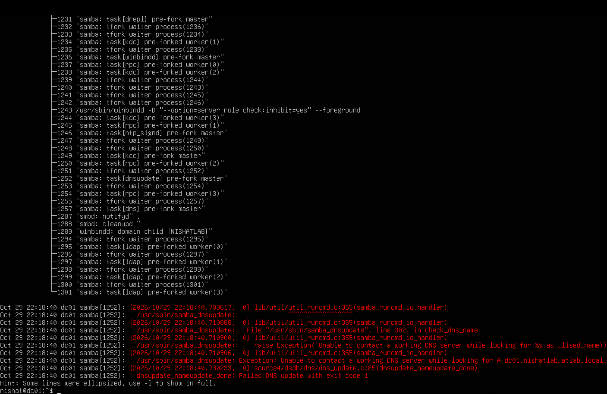

### Step 2 — Inspected DNS Resolver Configuration

Checked the server's DNS resolver configuration.

```bash
resolvectl status
```

Reviewed the configured DNS servers and resolver behavior affecting Active Directory name resolution.

**Screenshot 03 — Initial DNS Server Settings**

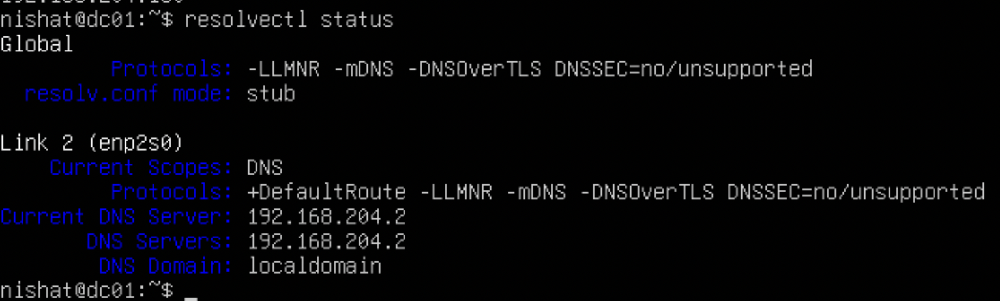

### Step 3 — Investigated DNS Port 53 Conflicts

Examined active DNS listeners.

```bash
sudo ss -tulpn | grep ':53'
```

Investigated potential conflicts involving Samba and systemd-resolved.

**Screenshot 04 — DNS Port 53 Conflict**

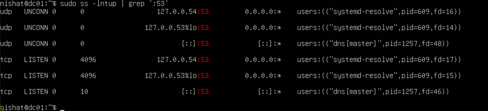

### Step 4 — Verified Active Directory LDAP DNS Records

Tested LDAP service discovery using DNS SRV records.

```bash
host -t SRV _ldap._tcp.nishatlab.local ::1
```

**Screenshot 05 — Active Directory LDAP DNS Record**

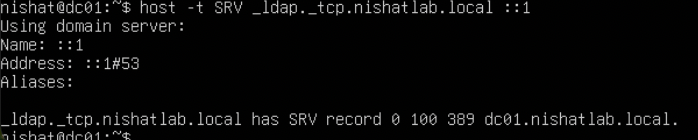

### Step 5 — Verified Kerberos DNS Records

Tested Kerberos service discovery.

```bash
host -t SRV _kerberos._udp.nishatlab.local ::1
```

**Screenshot 06 — Kerberos DNS Record**

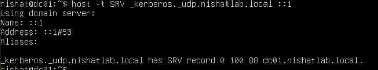

### Step 6 — Retested Internal DNS Resolution

Repeated DNS queries after investigating resolver configuration and Samba DNS settings.

```bash
host -t A dc01.nishatlab.local ::1
host -t SRV _kerberos._udp.nishatlab.local ::1
```

**Screenshot 07 — Kerberos DNS Resolution Fixed**

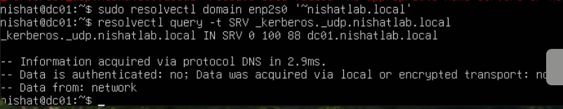

### Step 7 — Reviewed Netplan DNS Configuration

Updated the Ubuntu network configuration to control DNS resolver behavior.

Validated the Netplan configuration.

```bash
sudo netplan generate
```

**Screenshot 08 — Netplan DNS Configuration**

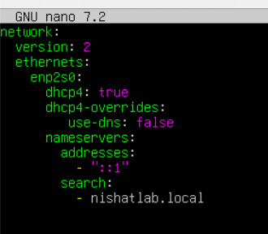

### Step 8 — Investigated External DNS Forwarding

Reviewed Samba DNS forwarding settings and tested external DNS resolution.

```bash
host -t A google.com ::1
host -t A google.com 192.168.204.2
```

**Screenshot 09 — Samba DNS Forwarding Test**

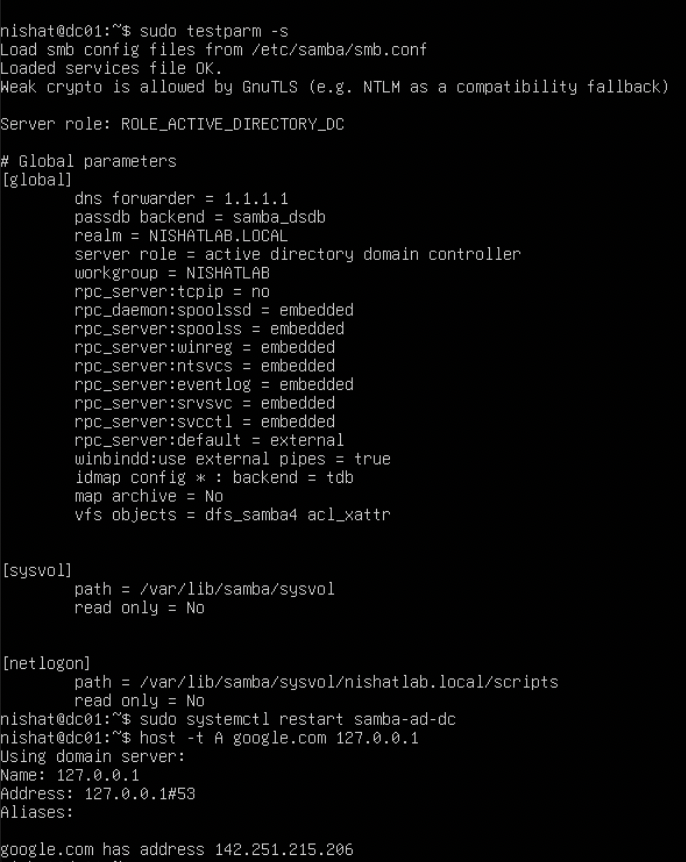

The tests helped distinguish Samba's local DNS behavior from upstream DNS resolution.

Some external DNS forwarding tests through Samba remained unsuccessful.

### Step 9 — Verified Active Directory DNS Zone Records

Queried the Active Directory DNS zone using Samba's administration tool.

```bash
samba-tool dns query dc01.nishatlab.local nishatlab.local @ ALL -U Administrator
```

The output displayed DNS zone information, including:

- SOA record
- NS record
- Domain Controller A record
- Active Directory DNS subdomains

**Screenshot 22 — Active Directory DNS Zone Verification**

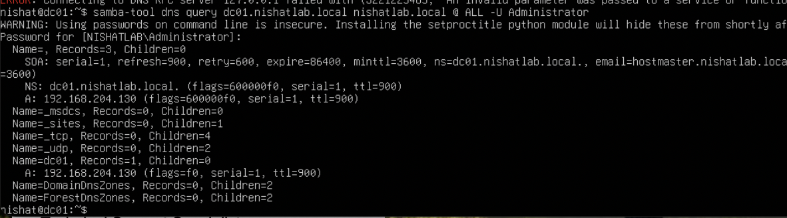

### Step 10 — Verified Samba DNS Forwarder Configuration

Inspected the DNS forwarder configured in Samba.

```bash
sudo samba-tool testparm --parameter-name="dns forwarder"
```

The output confirmed:

```text
192.168.204.2
```

**Screenshot 23 — Samba DNS Forwarder Configuration**

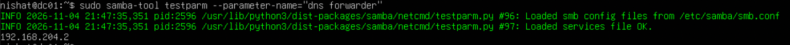

This confirmed the configured upstream DNS server, although it did not independently establish that forwarding through Samba was successful.

## Outcome

Successfully verified internal Active Directory DNS records, including LDAP and Kerberos service discovery.

Demonstrated DNS troubleshooting through service logs, resolver inspection, port conflict investigation, Netplan configuration, DNS zone queries, and forwarder verification.

External DNS forwarding issues were investigated, with some tests remaining unsuccessful.

## Skills Demonstrated

- DNS troubleshooting
- Active Directory DNS records
- Linux networking
- Netplan configuration
- Service log analysis
- Samba DNS administration
- DNS forwarding diagnostics

---

# Case 03 — Kerberos Authentication

## Objective

Verify that Active Directory domain accounts could authenticate through Kerberos.

## Steps Performed

### Step 1 — Authenticated the Domain Administrator

Requested a Kerberos Ticket Granting Ticket (TGT).

```bash
kinit Administrator@NISHATLAB.LOCAL
```

### Step 2 — Verified Successful Authentication

Inspected the Kerberos ticket cache.

```bash
klist
```

**Screenshot 10 — Kerberos Authentication Success**

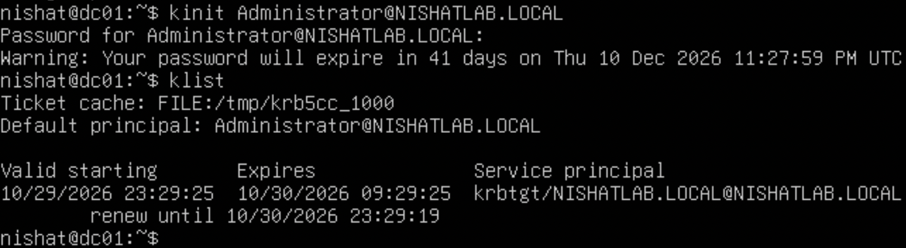

### Step 3 — Verified Kerberos Ticket Information

Reviewed the authenticated principal and ticket-granting service.

```bash
klist
```

**Screenshot 11 — Kerberos Authentication Verification**

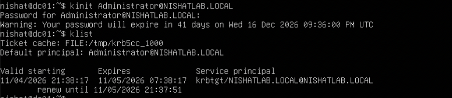

## Outcome

Successfully demonstrated Kerberos authentication and ticket verification against the Samba Active Directory Domain Controller.

## Skills Demonstrated

- Kerberos authentication
- Active Directory authentication
- Identity verification
- Authentication troubleshooting
- Ticket validation

---

# Case 04 — Active Directory User & Security Group Management

## Objective

Perform common IT Support and System Administration tasks involving domain user provisioning and security group administration.

## Steps Performed

### Step 1 — Created a Domain User

Created a standard Active Directory user account named `sarah`.

```bash
sudo samba-tool user create sarah
```

Verified the account.

```bash
sudo samba-tool user show sarah
```

**Screenshot 12 — Active Directory User Creation**

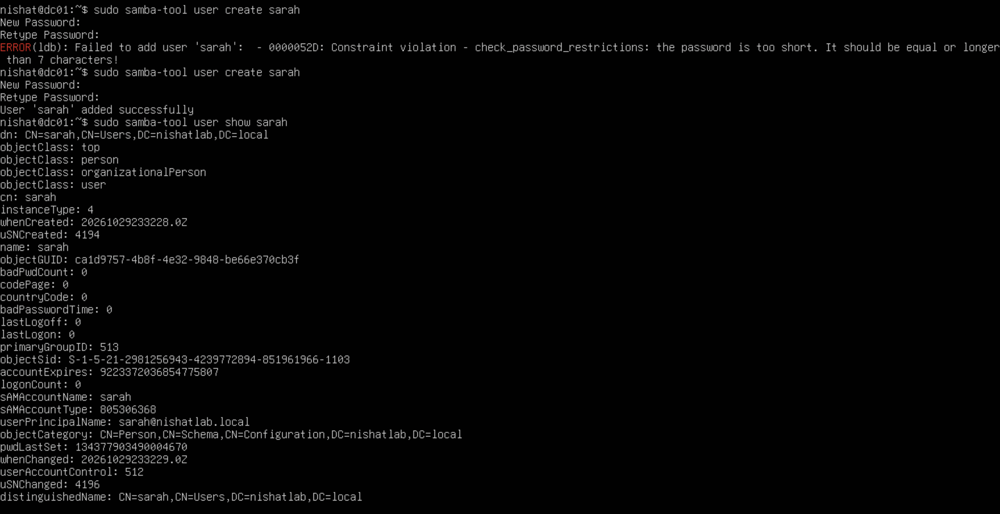

### Step 2 — Created an Active Directory Security Group

Created a security group named `IT-Support`.

```bash
sudo samba-tool group add IT-Support
```

**Screenshot 13 — Active Directory Security Group**

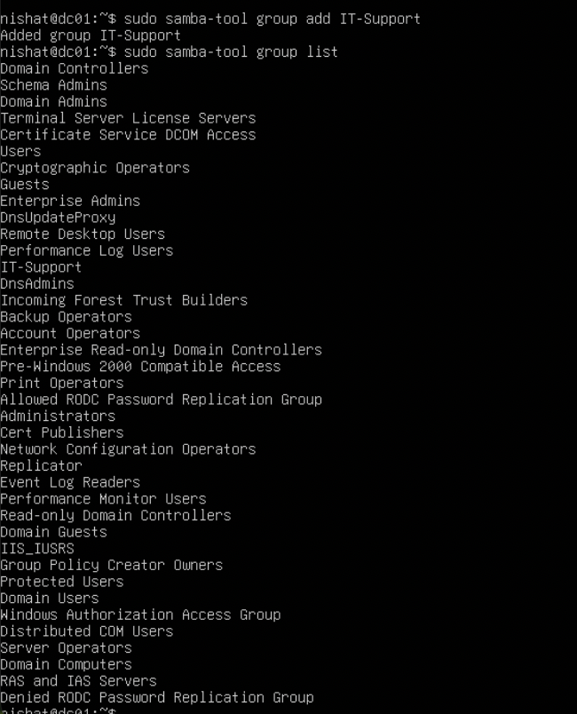

### Step 3 — Added the User to the Security Group

Added Sarah to the IT-Support group.

```bash
sudo samba-tool group addmembers IT-Support sarah
```

### Step 4 — Verified Security Group Membership

```bash
sudo samba-tool group listmembers IT-Support
```

The output confirmed that Sarah belonged to the IT-Support security group.

**Screenshot 14 — Security Group Membership**

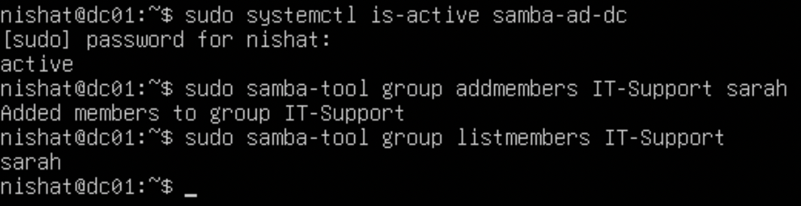

## Outcome

Successfully created and managed Active Directory user accounts and security groups.

The IT-Support group was subsequently used to control access to a departmental network share.

## Skills Demonstrated

- Active Directory user provisioning
- Security group administration
- Identity and Access Management (IAM)
- Group membership verification
- Group-based access management

---

# Case 05 — Active Directory User Account Lifecycle Management

## Objective

Simulate common Help Desk account administration responsibilities, including disabling accounts, re-enabling accounts, resetting passwords, and verifying authentication.

## Steps Performed

### Step 1 — Disabled a Domain User Account

Disabled Sarah's Active Directory account.

```bash
sudo samba-tool user disable sarah
```

Verified the disabled account status.

**Screenshot 15 — User Account Disabled**

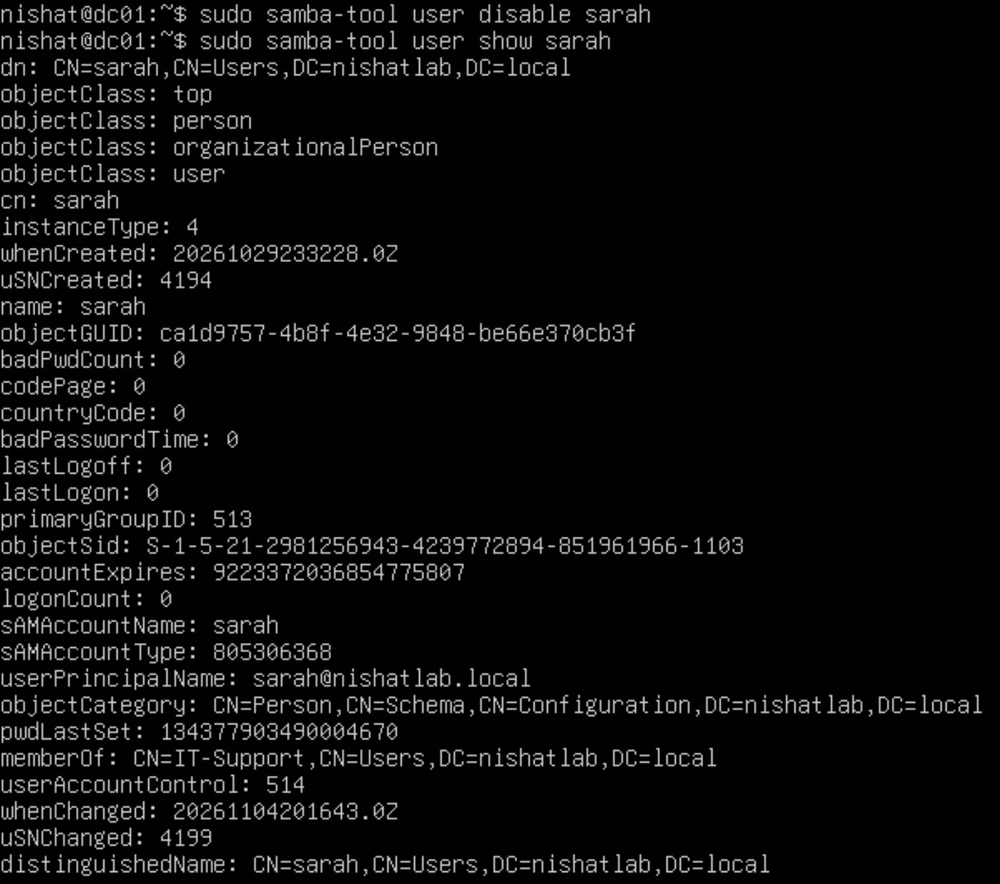

### Step 2 — Re-enabled the User Account

Re-enabled the account.

```bash
sudo samba-tool user enable sarah
```

Verified that the account was active again.

**Screenshot 16 — User Account Re-enabled**

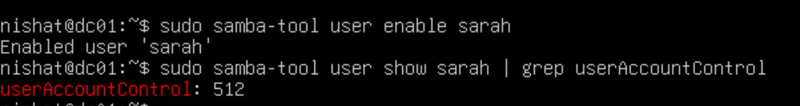

### Step 3 — Reset the User Password

Performed a password reset for the domain account.

```bash
sudo samba-tool user setpassword sarah -H /var/lib/samba/private/sam.ldb
```

Confirmed successful password reset.

**Screenshot 17 — User Password Reset**

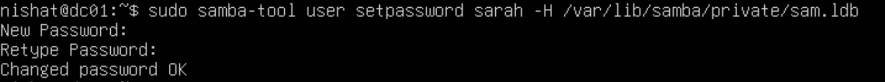

### Step 4 — Verified Kerberos Authentication

Tested authentication using the updated credentials.

```bash
kinit sarah@NISHATLAB.LOCAL
klist
```

Verified that the account successfully obtained a Kerberos ticket.

**Screenshot 18 — User Kerberos Authentication**

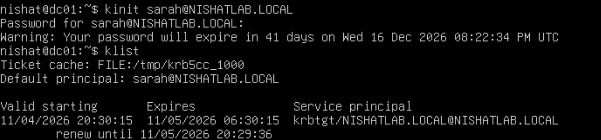

## Outcome

Successfully demonstrated user account disabling, re-enabling, password resetting, and Kerberos authentication verification.

These tasks simulate common account management requests handled by IT Support and Help Desk teams.

## Skills Demonstrated

- User account lifecycle management
- Help Desk account administration
- Password resets
- Identity and Access Management
- Kerberos authentication
- Account status verification

---

# Case 06 — Secure SMB File Sharing & Access Control

## Objective

Configure a departmental network share and restrict access using Active Directory security group membership.

## Scenario

An IT department requires a shared folder accessible only to authorized members of the IT-Support security group.

Two domain accounts were used to validate access restrictions.

| User | Security Group Membership | Expected Access |
|---|---|---|
| Sarah | IT-Support | Allowed |
| James | Not a member | Denied |

## Steps Performed

### Step 1 — Created the Shared Directory

Created a departmental directory.

```bash
sudo mkdir -p /srv/samba/IT-Department
```

Configured filesystem ownership and permissions to support group-based access restrictions.

### Step 2 — Configured the Samba Network Share

Added the departmental share to `/etc/samba/smb.conf`.

```ini
[IT-Department]
    path = /srv/samba/IT-Department
    browseable = yes
    read only = no
    valid users = @"NISHATLAB\IT-SUPPORT"
    force group = "NISHATLAB\IT-SUPPORT"
    create mask = 0660
    directory mask = 2770
```

Validated the configuration.

```bash
sudo testparm -s
```

**Screenshot 19 — Samba File Share Configuration**

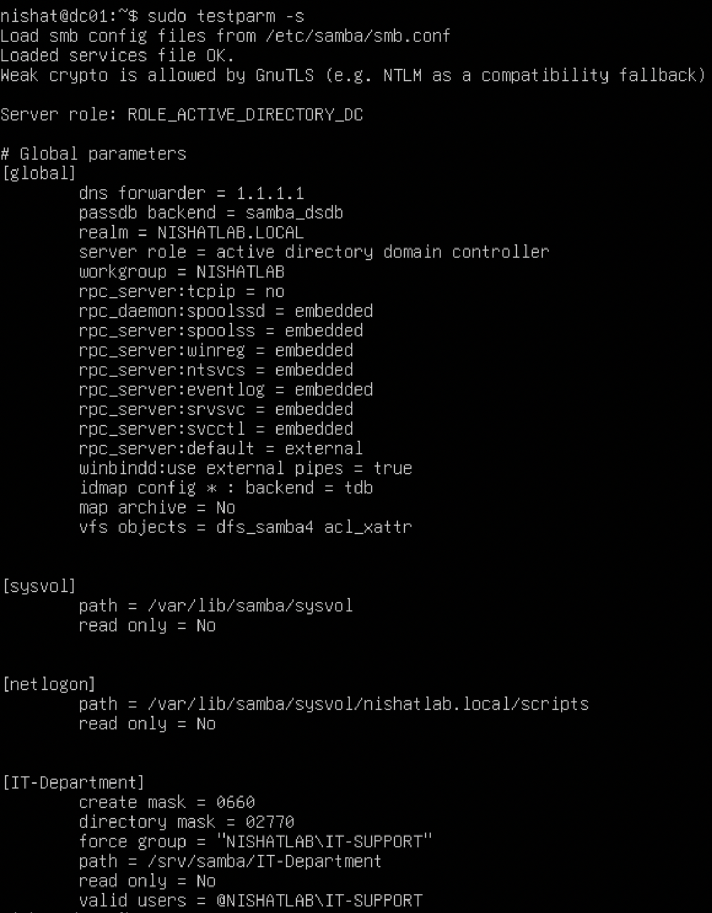

### Step 3 — Tested Authorized Access

Connected to the departmental share using Sarah's domain account.

```bash
smbclient //127.0.0.1/IT-Department -U 'NISHATLAB\sarah'
```

Uploaded a test file.

```text
put sarah-test.txt
```

Verified the uploaded file using:

```text
ls
```

**Screenshot 20 — Authorized File Share Access**

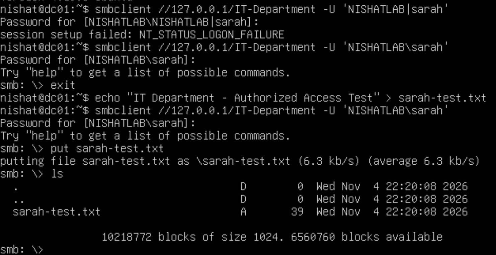

### Step 4 — Tested Unauthorized Access

Created a second domain account named `james`, without adding it to the IT-Support security group.

Attempted to access the same share.

```bash
smbclient //127.0.0.1/IT-Department -U 'NISHATLAB\james'
```

The server rejected the connection.

```text
NT_STATUS_ACCESS_DENIED
```

**Screenshot 21 — Unauthorized Share Access Denied**

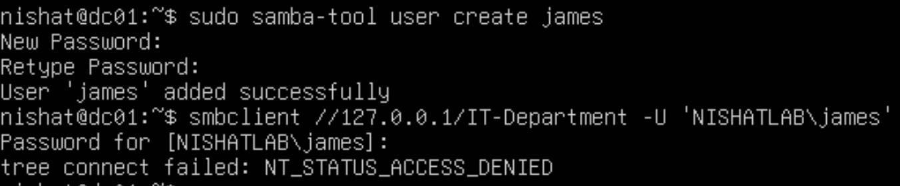

## Verification Results

| Test | Result |
|---|---|
| Authorized user authentication | Successful |
| Authorized file upload | Successful |
| Uploaded file verification | Successful |
| Unauthorized user connection | Access denied |
| Security group membership | Verified |

## Outcome

Successfully implemented group-based access control using Samba Active Directory security groups and Linux filesystem permissions.

The authorized user accessed the departmental share and uploaded a file, while an unauthorized domain user was denied access.

This demonstrated practical application of the principle of least privilege.

## Skills Demonstrated

- SMB/CIFS file sharing
- Linux filesystem permissions
- Active Directory security groups
- Access control
- Least privilege
- Authentication and authorization testing

---

# Key Skills Demonstrated

## Linux Server Administration

- Ubuntu Server administration
- Linux command-line operations
- System service configuration
- Network configuration
- Log analysis and troubleshooting

## Active Directory & Identity Management

- Samba Active Directory Domain Controller
- Domain user provisioning
- Security group management
- User account disabling and re-enabling
- Password resets
- Kerberos authentication

## Networking & Access Control

- DNS A and SRV records
- LDAP and Kerberos service discovery
- DNS troubleshooting
- SMB file sharing
- Linux filesystem permissions
- Group-based access restrictions
- Authorized and unauthorized access testing

## IT Support & Troubleshooting

- Diagnosing authentication problems
- Investigating DNS resolution failures
- Validating configuration changes
- Reviewing system logs
- Documenting technical procedures and outcomes

---

# Project Outcome

Successfully built and administered a Linux-based Active Directory environment using Ubuntu Server and Samba.

The project demonstrates practical experience with:

- Active Directory Domain Controller administration
- DNS troubleshooting and service discovery
- Kerberos authentication
- User and security group management
- Account lifecycle administration
- SMB file sharing and access control
- Linux server troubleshooting

The lab provided hands-on experience with responsibilities relevant to **IT Support, Help Desk, Desktop Support, Junior System Administration, and Identity and Access Management** roles.

---

# Future Improvements

- Join a compatible Windows client to the Active Directory domain.
- Explore graphical Active Directory administration tools.
- Configure additional departmental network shares.
- Implement file access auditing.
- Explore automated user provisioning.
- Add centralized logging and security monitoring.

---

**Project Type:** Personal Home Lab

**Focus Areas:** IT Support | System Administration | Identity & Access Management | Cybersecurity

*All activities were performed in a personal virtualized lab environment for educational and professional portfolio development.*
